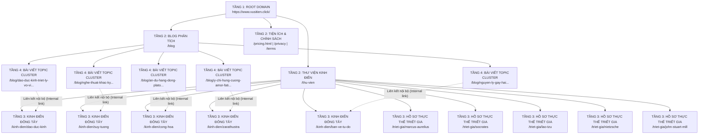

# CẤU TRÚC KIẾN TRÚC THÔNG TIN & URL TREE (STRUCTURE.MD)
**Dự án:** Sophia Codex (`https://www.vusitien.click`)  
**Khung kiến trúc:** 4 Tầng Phân Cấp Silo & Topic Cluster Hub-and-Spoke  
**Tiêu chuẩn định tuyến:** Clean URLs Rewrite via Vercel Engine  

---

## 1. SƠ ĐỒ PHÂN TẦNG KIẾN TRÚC WEBSITE (4 TIERS ARCHITECTURE)

---

## 2. PHÂN BỔ TÀI NGUYÊN THU THẬP (CRAWL BUDGET ALLOCATION)

| Tầng nội dung | Số lượng URLs | Tần suất cập nhật (`changefreq`) | Trọng số ưu tiên (`priority`) | Mục tiêu chiến lược |
| :--- | :---: | :---: | :---: | :--- |
| **Trang chủ & Hubs** | 3 | Hàng ngày (`daily`) | 1.0 - 0.9 | Nhận diện thương hiệu & điều hướng trung tâm |
| **Kinh điển Toàn văn** | 5 | Hàng tuần (`weekly`) | 0.9 | Nguồn sơ cấp (Primary Canonical Works), giữ chân người đọc |
| **Thực thể Triết gia** | 5 | Hàng tháng (`monthly`) | 0.8 | Entity Grounding (Wikidata, Wikipedia `sameAs`) |
| **Topic Cluster Blogs** | 5 | Hàng tuần (`weekly`) | 0.8 | Đón Long-tail Keywords & Chiếm Featured Snippet Top 0 |
| **Trang phụ trợ** | 3 | Định kỳ (`weekly` / `yearly`) | 0.8 - 0.3 | Minh bạch pháp lý, bảng giá và điều khoản dịch vụ |

---

## 3. NGUYÊN TẮC LIÊN KẾT NỘI BỘ (INTERNAL LINKING SILO)

1. **Mối quan hệ Hub-and-Spoke 2 chiều:**
   - Mỗi bài blog vệ tinh (Spoke) phân tích sâu về một tư tưởng triết học **bắt buộc phải có ít nhất 02 link nội bộ** trỏ về bản dịch tác phẩm kinh điển tương ứng (Hub).
   - Tác phẩm kinh điển (Hub) có widget dẫn dắt sang các bài phân tích ứng dụng thực tế và mời gọi đối thoại cùng **Socrates AI**.
2. **Cơ chế Không cụt dòng (No Dead-ends):**
   - 100% các trang bài viết và chương sách đều có thanh điều hướng chân trang (Next / Previous Chapter) và nút CTA mở nhanh khung đối thoại Socrates AI, đảm bảo người dùng và bot không bao giờ gặp điểm cụt.
